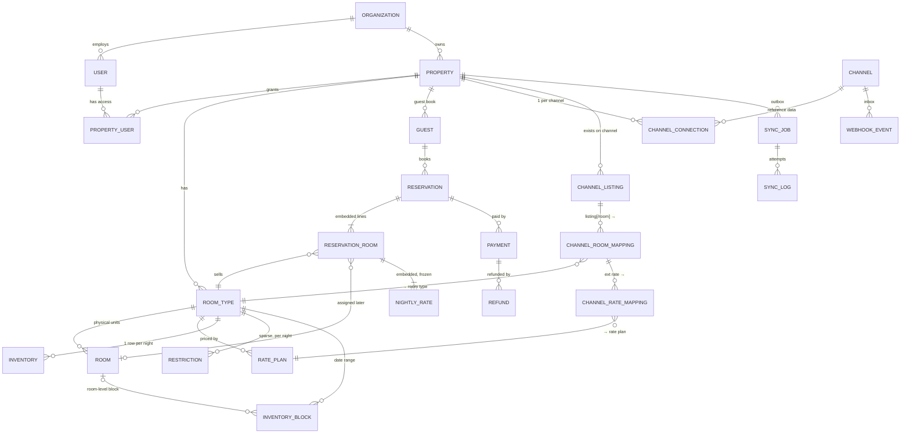

# Tirvona MongoDB data architecture

MongoDB Atlas · Mongoose 8 · NestJS 11 · TypeScript. There is one database (`tirvona`) for the whole modular monolith.

The code is the source of truth. This document explains the decisions behind it and points to where each one lives.

| Deliverable | Where |
|---|---|
| 1 Architecture, 2 Relationship diagram | §1, §2 below |
| 3 Mongoose schemas, TypeScript types, enums | [src/database/schemas/](../src/database/schemas/), [enums.ts](../src/database/enums.ts) |
| 4 Index definitions, 5 Validation | §4, §5 (declared next to each schema) |
| 6 Embedding vs referencing | §6 |
| 7 Inventory, 11 Double-booking prevention | §7, [inventory.service.ts](../src/database/services/inventory.service.ts) |
| 8 Reservations, 16 Reservation txn, 17 Cancellation txn | §8, [reservation.service.ts](../src/database/services/reservation.service.ts) |
| 9 Channel mapping, 19 Channel mapping queries | §9, [channel-mapping.service.ts](../src/database/services/channel-mapping.service.ts) |
| 10 Webhook idempotency | §10, [webhook.service.ts](../src/database/services/webhook.service.ts) |
| 12 Transaction strategy | §12, [transaction.ts](../src/database/common/transaction.ts) |
| 13 Seed script | [scripts/seed.ts](../scripts/seed.ts) |
| 14 Sample queries, 15 Availability, 18 Calendar | §14, [availability.service.ts](../src/database/services/availability.service.ts) |
| 20 Atlas configuration | §20 |
| Proof that it works | [scripts/verify.ts](../scripts/verify.ts), 44 checks against a real replica set |

---

## 1. Architecture

```
                 ┌──────────── one MongoDB database: tirvona ────────────┐
 NestJS modular  │                                                       │
 monolith        │  identity     organizations · users · property_users  │
 ─────────────   │  property     properties · room_types · rooms         │
 PMS             │  commercial   rate_plans · restrictions               │
 Booking engines │  inventory    inventory · inventory_blocks            │
 Channel manager │  bookings     guests · reservations · payments ·      │
 Payments        │               refunds                                 │
                 │  channels     channels · channel_connections ·        │
                 │               channel_listings · channel_room_mappings│
                 │               · channel_rate_mappings                 │
                 │  plumbing     webhook_events (inbox) · sync_jobs      │
                 │               (outbox) · sync_logs · notifications ·  │
                 │               audit_logs                              │
                 └───────────────────────────────────────────────────────┘
```

**Principles**

1. **Tenancy is Organization → Property.** Every operational document carries `propertyId`, and every query filters on it. `organizationId` sits on users, properties and audit logs. The authorization layer resolves the caller's allowed `propertyId`s from `property_users`, using the `{userId, propertyId}` index, and scopes each request to them.
2. **Room type ≠ physical room ≠ channel listing.** Inventory is counted per *room type per night*. Physical rooms are assigned to reservation lines later. Channel listings map *to* room types and never to rooms.
3. **One master inventory.** TIRVONA and DIRECT read `inventory` directly. External OTAs receive pushes of the same rows. The PMS is the only writer.
4. **Every multi-document write is a transaction scoped to one property.** This keeps the door open to sharding on `propertyId` later (§20).
5. **Integrations go through an inbox and an outbox.** Inbound webhooks land in `webhook_events` before any processing. Outbound syncs are `sync_jobs` rows written in the same transaction as the change that caused them.
6. **Channel-agnostic core.** Nothing in the schema encodes an OTA wire format. Channel adapters, written against each OTA's documented partner API, translate to and from `NormalizedReservationEvent` and the absolute inventory, rate and restriction values.

**Conventions**

- **Money** is an integer in minor units (paise). ₹3,500.00 is stored as `350000`, and every amount has an ISO-4217 `currency` next to it. Integers keep sums exact.
- **Hotel dates** (`inventory.date`, `checkIn`, `checkOut`, restriction and block dates) are *calendar dates in the property's time zone*, stored as `YYYY-MM-DDT00:00:00Z`. Ranges are half-open: a stay `[checkIn, checkOut)` consumes the nights `checkIn … checkOut-1`. Helpers are in [dates.ts](../src/database/common/dates.ts).
- **Enums** are string enums, so stored values are readable and reordering members is safe.

## 2. Data relationship diagram



Channel path from the brief: `Property → channel_connections → channel_listings → channel_room_mappings → room_types`.

## 4. Index definitions

Each index exists because a named query needs it. Where one compound index's prefix covers a simpler requested index (for example `{propertyId, slug}` covers `propertyId`), the simpler one is not created.

| Collection | Index | Serves |
|---|---|---|
| organizations | `{slug}` **unique** | tenant lookup |
| users | `{email}` **unique**; `{organizationId, role}` | login; org staff list |
| property_users | `{propertyId, userId}` **unique**; `{userId, propertyId}` | staff of a property; "my properties" on every request |
| properties | `{organizationId, slug}` **unique**; `{ownerId}`; `{slug}` | org listing; owner; public direct-booking URL |
| room_types | `{propertyId, slug}` **unique** | |
| rooms | `{propertyId, roomNumber}` **unique**; `{roomTypeId, status}` | room picker, housekeeping |
| rate_plans | `{propertyId, roomTypeId, code}` **unique** | also used by the availability `$lookup` |
| **inventory** | `{propertyId, roomTypeId, date}` **unique** | booking decrement, availability, calendar (propertyId prefix + date bounds) |
| inventory_blocks | `{propertyId, roomTypeId, startDate, endDate}`; `{roomId, startDate}` partial (roomId set) | calendar overlay; room conflict check |
| restrictions | `{propertyId, roomTypeId, date}` **unique** | |
| guests | `{propertyId, email}` partial; `{propertyId, phone}` partial | returning-guest match |
| **reservations** | `{reservationCode}` **unique** | front desk |
| | `{source, externalReservationId}` **unique partial** (`externalReservationId` is a string) | OTA idempotency: AIRBNB+ABC123 exists once |
| | `{propertyId, idempotencyKey}` **unique partial** | direct-booking retry safety |
| | `{propertyId, checkIn, checkOut}` | overlap / calendar / occupancy |
| | `{propertyId, status, checkIn}` | arrivals, in-house, pending boards |
| | `{reservationRooms.roomId, checkIn}` (multikey) | room-assignment conflicts, tape chart |
| | `{guestId, checkIn:-1}` | guest history |
| | `{holdExpiresAt}` partial (`status: PENDING`) | hold-expiry sweeper |
| payments | `{reservationId}`; `{provider, providerPaymentId}` **unique partial**; `{propertyId, createdAt:-1}` | gateway webhook idempotency |
| refunds | `{reservationId}`; `{paymentId}`; `{provider, providerRefundId}` **unique partial**; `{status, createdAt}` | refund worker |
| channels | `{code}` **unique** | |
| channel_connections | `{propertyId, channel}` **unique** | property + channel |
| channel_listings | `{channel, externalListingId}` **unique**; `{propertyId, channel}` | inbound routing; see the note below |
| channel_room_mappings | `{channelListingId, externalRoomId}` **unique**; `{propertyId, roomTypeId, channel}` | no duplicate mappings; outbound fan-out |
| channel_rate_mappings | `{channelRoomMappingId, externalRatePlanId}` **unique**; `{propertyId, ratePlanId}` | inbound rate resolve; rate fan-out |
| webhook_events | `{channel, externalEventId}` **unique**; `{status, createdAt}` | idempotency; worker queue |
| sync_jobs | `{status, scheduledAt}`; `{propertyId, channel, createdAt:-1}`; `{completedAt}` TTL 30d partial (SUCCESS) | worker claim; UI history |
| sync_logs | `{propertyId, channel, createdAt:-1}`; `{createdAt}` TTL 90d | |
| notifications | `{status, createdAt}`; `{userId, createdAt:-1}` partial; `{reservationId}` partial | dispatcher; inbox; reservation page |
| audit_logs | `{propertyId, createdAt:-1}`; `{organizationId, createdAt:-1}`; `{entityType, entityId, createdAt:-1}` | |

**Deliberate deviation:** the brief asks for `channel_listings` unique on `propertyId + channel + externalListingId`. The code makes `channel + externalListingId` unique instead. That is strictly stronger and implies the requested constraint. An external listing ID identifies one real listing, so a second tenant must not be able to claim it, and inbound webhooks carry the listing ID but not our `propertyId`.

**Creating indexes.** Production runs with `autoIndex: false`. `npm run db:setup` creates collections, validators and indexes idempotently, and `--prune` also drops undeclared indexes. On large collections, build new indexes with Atlas's rolling index build.

## 5. Validation

There are three layers.

1. **Mongoose schema.** Every schema sets `strict: 'throw'`, so unknown fields are an error and are never silently dropped. It also sets `strictQuery: 'throw'`, because a typo in a filter must not silently become "match all" in an `updateMany`. The schema layer also enforces enums, E.164 phones, ISO currency/country codes, IANA time-zone checks, integer minor-unit money, UTC-midnight calendar dates and bounded arrays. It rejects plaintext `passwordHash` values and unencrypted token fields.
2. **Cross-field `pre('validate')` hooks.** Reservations check that `nightlyRates` has one entry per night, that `subtotal = Σ nightly × qty`, `total = subtotal + tax − discount` and `roomId ⇒ quantity 1`, and that OTA sources have an `externalReservationId`. Rate plans check that `NON_REFUNDABLE` is not refundable. Blocks check that `end > start`. Inventory checks its counter invariant. Restrictions check `max ≥ min`.
3. **Server-side `$jsonSchema` + `$expr` validators** ([setup-db.ts](../scripts/setup-db.ts)) on `inventory`, which enforce `available, sold, blocked, total, overbooked ≥ 0` and `available + sold + blocked = total + overbooked`, and on `reservations`, which enforce `checkIn < checkOut` and non-negative money. They apply to *every* writer, including `mongosh`. The verify script shows a raw `available: -1` write being rejected with code 121.

Secrets and PII: `redactSecrets()` runs in `pre('validate')` on sync logs, payment/refund/connection metadata, notifications and audit logs. It masks keys such as `*token*`, `authorization`, `password*` and `*secret*`, plus Luhn-valid card numbers. OAuth tokens and guest document numbers are AES-256-GCM envelopes (`v1:…`) with `select: false`.

## 6. Embedding vs referencing

| Data | Decision | Why |
|---|---|---|
| `reservationRooms[]` and their `nightlyRates[]` | **Embed** | Always read and written with the reservation, bounded (≤50 lines, ≤90 nights), and historical. A single-document write keeps the reservation's totals consistent without a transaction. |
| Rate plan and cancellation policy *as sold* | **Embed a snapshot** in each line | Prices and policy must not change when the rate plan is edited. `ratePlanId` is also kept for reporting. |
| Guest name/email/phone | **Reference `guestId` + embed a snapshot** | The guest book is reusable (history, marketing), but the booking must show who booked even after the guest record is edited. |
| Status history | **Embed** (bounded 50) | Tiny, and only meaningful with its reservation. |
| Room type/property name on lines | **Embed** `roomTypeName` | Invoices and history survive renames. |
| Inventory | **Own collection**, one doc per room type per night | High write contention and high cardinality (types × 365+ days). Row-level atomic `$inc` with a conditional filter is the double-booking guard. Embedding nights in the room type would make one hot 16 MB-bound document. |
| Restrictions | **Own collection**, sparse | A separate write path (revenue management, channel pushes). Most nights have no restriction. |
| Physical rooms | **Own collection**, referenced from lines | Reassigned independently; carries `assignmentVersion` for conflict detection. |
| Payments, refunds | **Own collections** | Independent lifecycle, gateway idempotency keys, and audit. Totals are denormalised to `reservation.amountPaid/amountRefunded`. |
| Channel listings/mappings | **Own collections** | Many-to-one onto room types, queried from both directions (inbound and outbound). |
| Guest documents | **Embed** (≤10) with encrypted number | Only read with the guest. |
| Property images, amenities | **Embed** (bounded) | Read with the property and never queried alone. |
| Logs, jobs, events, notifications, audit | **Own collections** | Append-heavy, TTL or archival. |

## 7. Inventory implementation

`inventory` has one row per `(propertyId, roomTypeId, date)`, with counters:

```
available + sold + blocked == total + overbooked        (all ≥ 0)
```

| Operation | Update (inside a transaction) | Guard |
|---|---|---|
| Book (direct/PMS) | `$inc {available:-q, sold:+q}` | filter `available ≥ q, stopSell:false`; `modifiedCount == nights` |
| Book (OTA, already sold on their side) | pipeline: take `min(available,q)` from available, rest into `overbooked` | `modifiedCount == nights`; owner alert |
| Cancel / no-show / hold expiry | pipeline: `sold −q`; clear `overbooked` first, then `available +` | filter `sold ≥ q` |
| Block (maintenance, owner, event…) | `$inc {available:-q, blocked:+q}` + `inventory_blocks` row | filter `available ≥ q` |
| Release block | `$inc {blocked:-q, available:+q}` | block `ACTIVE→RELEASED` conditional |
| Stop sell / closed | restriction upsert, mirrored to `inventory.stopSell` | same transaction |
| Add/remove physical room | `roomType.totalRooms ± 1`, `$inc {total, available}` on future nights | removal requires `available ≥ 1` on every future night |

- **Materialisation.** `ensureInventory` upserts rows with `$setOnInsert` from `roomType.totalRooms`, which is idempotent and never touches existing rows. A nightly job (`extendHorizon`) keeps `property.bookingHorizonDays` of rows ahead. Missing rows mean "beyond the horizon, not sellable". OTA imports materialise on demand.
- **Restrictions** (min/max stay, CTA, CTD, closed) follow channel-manager conventions ([restrictions.ts](../src/database/common/restrictions.ts)). Min/max stay and CTA are read on the arrival date, CTD on the departure date, and closed/stop-sell on every night.

## 8. Reservation implementation

- A `reservations` document embeds `reservationRooms[]`. The service **expands `quantity: N` into N lines of quantity 1**, so each line can receive its own `roomId` later (null → Room 104 via `assignRoom`).
- Every line stores `nightlyRates[{date, amount}]`, `subtotal`, `tax`, `total` and a frozen `ratePlan` snapshot. Direct and marketplace bookings are always priced server-side; client-supplied prices are rejected. OTA and staff bookings may carry their own nightly prices.
- Status defaults: OTA, walk-in, phone and agent bookings start `CONFIRMED`. `DIRECT` and `TIRVONA` start `PENDING` with `holdExpiresAt` = now + 20 min. A captured payment (`recordPayment`) confirms the booking. `expirePendingHolds` cancels unpaid holds and releases their inventory.
- Status transitions: `PENDING → CONFIRMED → CHECKED_IN → CHECKED_OUT`, `PENDING|CONFIRMED → CANCELLED`, `CONFIRMED → NO_SHOW`. `statusHistory` records who changed the status and when. Confirm (via payment) and cancel are implemented. Check-in, check-out and no-show are listed under next steps.
- `reservationCode` is `TRV-` followed by 8 Crockford base32 characters (~10¹² space; a collision retries).

## 9. Channel mapping implementation

```
channel_connections  (property × channel)     credentials (encrypted), health, lastSyncAt
channel_listings     (channel × externalId)   Airbnb listing 123456 / Booking.com hotel 9900123
channel_room_mappings(listing × extRoomId)    → roomTypeId   + syncAvailability/Rates/Restrictions flags
channel_rate_mappings(roomMapping × extRate)  → ratePlanId   + markup PERCENTAGE | FIXED | NONE
```

- **Airbnb-style** channels, where one listing is one unit type, map with `externalRoomId: null`. **Booking.com/Agoda-style** channels, where one hotel listing holds many room types, map with one row per `externalRoomId`. The same unique index covers both.
- Several listings can map to the same room type (Airbnb + Booking.com + Agoda all selling Deluxe AC), and all of them draw on the same inventory rows.
- **Outbound:** every inventory, rate or restriction change calls `SyncJobService.enqueueForRoomType` in its transaction. That call reads `getOutboundTargets` (active mappings on `CONNECTED` external channels, filtered by sync flags) and inserts one job per target. The worker reads *current* master data when it runs and pushes absolute values, so jobs are idempotent and order-independent. The channel price is `ChannelMappingService.channelPrice(base, markup)`.
- **Inbound:** `resolveInboundRoom(channel, externalListingId, externalRoomId)` returns the property and room type, and `resolveInboundRatePlan` returns the rate plan.

## 10. Webhook idempotency

1. **Ingest (HTTP handler).** The adapter verifies the signature, then calls `webhooks.ingest(...)`, which does an `insertOne` into `webhook_events` and returns 2xx. A duplicate key on `{channel, externalEventId}` means a redelivery, which is acknowledged and not reprocessed. If the channel supplies no event ID, `sha256(rawBody)` is used. Events with invalid signatures are stored as `IGNORED` for forensics.
2. **Process (worker).** `claimNext()` leases the oldest `RECEIVED` event, or a `PROCESSING` event whose lease expired, with an atomic `findOneAndUpdate`. The adapter normalises the payload, and `applyReservationEvent` creates or cancels the reservation.
3. **Second line of defence.** Even if the same booking arrives under two different event IDs, the reservations index `{source, externalReservationId}` guarantees one reservation. The verify script fires 6 concurrent deliveries and gets 1 reservation and 1 inventory decrement.
4. Failures go back to `RECEIVED` for retry, up to 10 attempts, and then to `FAILED` for a human.

The same pattern applies to payment webhooks, with `{provider, providerPaymentId}` unique on `payments`.

## 11. Double-booking prevention

These layers are independent. Each one alone prevents `available < 0`.

1. **Conditional atomic update.** `updateMany({…night range, stopSell:false, available:{$gte:q}}, {$inc:{available:-q, sold:q}})`. MongoDB evaluates the filter and applies the `$inc` atomically per document.
2. **All-or-nothing across nights.** The update runs in a transaction, and the service requires `modifiedCount === nights`. Otherwise it throws, and the abort rolls back the nights that did decrement. This is verified with a sold-out middle night.
3. **Write-conflict serialisation.** Two transactions that touch the same inventory row cannot both commit. The loser gets `WriteConflict` (a `TransientTransactionError`), `withTransaction` re-runs it, and the retry sees `available = 0` and fails cleanly. This is verified with 25 concurrent requests for 1 room: 1 succeeds and 24 are sold out.
4. **Server-side validator.** `available ≥ 0` and the counter equation are enforced by MongoDB itself.
5. **Physical rooms.** `assignRoom` and room-level blocks `$inc rooms.assignmentVersion` inside their transaction before checking for overlaps. Concurrent assigners of the same room therefore conflict, which prevents write skew. This is verified with two stays racing for room 105.

## 12. MongoDB transaction strategy

- **Where:** anything that must change more than one document atomically. That covers reservation create/cancel (inventory rows + reservation + guest + outbox + audit), payment capture (payment + reservation), blocks (block + inventory), restrictions (restrictions + inventory.stopSell), capacity changes (room type + inventory) and room assignment (room + reservation).
- **Where not:** single-document updates (job claims, webhook ingest, status flips outside bookings), which are already atomic. Also materialisation (`ensureInventory`), which is idempotent and kept out of transactions to keep them short.
- **Settings:** `readConcern: snapshot`, `writeConcern: majority`, `readPreference: primary`, run through `connection.transaction()` (the driver's `withTransaction`). This retries the callback on `TransientTransactionError` and the commit on `UnknownTransactionCommitResult`.
- **Rules for callbacks:** pass `session` to every operation. No external I/O, because the callback may run several times. Write outbox rows (`sync_jobs`, `notifications`, `refunds`) and let workers act after commit. Read reference data (property, rate plans) *before* the transaction. Keep transactions to tens of documents and well under a second.
- **Scope:** each transaction touches one property's documents, which keeps it single-shard if the cluster is ever sharded on `propertyId`.
- **Idempotency** comes from unique indexes, not from reads: `{source, externalReservationId}`, `{propertyId, idempotencyKey}`, `{provider, providerPaymentId}`, `{channel, externalEventId}`. A duplicate-key error aborts the transaction, and the service returns the existing document.

## 14. Sample MongoDB queries (mongosh)

```js
const pid = ObjectId('…'), dlx = ObjectId('…');
const D = (s) => ISODate(s + 'T00:00:00Z');

// ---- 15. Availability: every room type, stay 2026-10-05 → 2026-10-08 (3 nights)
db.inventory.aggregate([
  { $match: { propertyId: pid, date: { $gte: D('2026-10-05'), $lt: D('2026-10-08') } } },
  { $group: { _id: '$roomTypeId', nights: { $sum: 1 }, minAvailable: { $min: '$available' }, anyStopSell: { $max: '$stopSell' } } },
  { $match: { nights: 3, anyStopSell: false, minAvailable: { $gte: 1 } } },
  { $lookup: { from: 'room_types', localField: '_id', foreignField: '_id', as: 'roomType' } },
  { $unwind: '$roomType' },
  { $lookup: { from: 'restrictions', localField: '_id', foreignField: 'roomTypeId', as: 'restrictions',
      pipeline: [{ $match: { propertyId: pid, date: { $gte: D('2026-10-05'), $lte: D('2026-10-08') } } }] } },
  { $lookup: { from: 'rate_plans', localField: '_id', foreignField: 'roomTypeId', as: 'ratePlans',
      pipeline: [{ $match: { propertyId: pid, status: 'ACTIVE' } }, { $project: { code: 1, basePrice: 1 } }] } },
]);

// ---- 11. The atomic decrement (inside a transaction; check modifiedCount === 3)
db.inventory.updateMany(
  { propertyId: pid, roomTypeId: dlx, date: { $gte: D('2026-10-05'), $lt: D('2026-10-08') }, stopSell: false, available: { $gte: 1 } },
  { $inc: { available: -1, sold: 1 }, $currentDate: { updatedAt: true } });

// ---- 18. Calendar grid (14 days) + overlapping reservations
db.inventory.find({ propertyId: pid, date: { $gte: D('2026-10-01'), $lt: D('2026-10-15') } },
                  { roomTypeId: 1, date: 1, total: 1, sold: 1, blocked: 1, available: 1, stopSell: 1 }).sort({ roomTypeId: 1, date: 1 });
db.reservations.find({ propertyId: pid,
  checkIn: { $lt: D('2026-10-15'), $gte: D('2026-07-03') },   // lower bound = from − 90 nights (max stay) keeps the scan bounded
  checkOut: { $gt: D('2026-10-01') },
  status: { $in: ['PENDING', 'CONFIRMED', 'CHECKED_IN', 'CHECKED_OUT'] } },
  { reservationCode: 1, status: 1, guest: 1, checkIn: 1, checkOut: 1, 'reservationRooms.roomId': 1, 'reservationRooms.roomNumber': 1 });

// ---- Front desk
db.reservations.find({ propertyId: pid, status: 'CONFIRMED', checkIn: D('2026-10-05') });            // arrivals
db.reservations.find({ propertyId: pid, status: 'CHECKED_IN' });                                      // in-house
db.reservations.find({ propertyId: pid, status: 'CHECKED_IN', checkOut: D('2026-10-05') });           // departures
db.reservations.findOne({ source: 'AIRBNB', externalReservationId: 'HMSEED0001' });                    // OTA lookup

// ---- Occupancy per night for a month
db.inventory.aggregate([
  { $match: { propertyId: pid, date: { $gte: D('2026-10-01'), $lt: D('2026-11-01') } } },
  { $group: { _id: '$date', total: { $sum: '$total' }, sold: { $sum: '$sold' } } },
  { $project: { occupancyPct: { $round: [{ $multiply: [{ $divide: ['$sold', { $max: ['$total', 1] }] }, 100] }, 1] } } },
  { $sort: { _id: 1 } }]);

// ---- Revenue by source (stays checking in this month, minor units)
db.reservations.aggregate([
  { $match: { propertyId: pid, checkIn: { $gte: D('2026-10-01'), $lt: D('2026-11-01') }, status: { $nin: ['CANCELLED'] } } },
  { $group: { _id: '$source', bookings: { $sum: 1 }, revenue: { $sum: '$total' }, roomNights: { $sum: { $multiply: ['$nights', { $size: '$reservationRooms' }] } } } }]);

// ---- 19. Channel mapping
// Inbound: Booking.com hotel 9900123, room "mock-bcom-room-fam" → room type
const l = db.channel_listings.findOne({ channel: 'BOOKING_COM', externalListingId: 'mock-bcom-9900123' });
db.channel_room_mappings.findOne({ channelListingId: l._id, externalRoomId: 'mock-bcom-room-fam' });
// Outbound: which listings consume Deluxe AC?
db.channel_room_mappings.find({ propertyId: pid, roomTypeId: dlx, status: 'ACTIVE', syncAvailability: true });
// Listings not mapped to any room type (they sell nothing)
db.channel_listings.aggregate([{ $match: { propertyId: pid } },
  { $lookup: { from: 'channel_room_mappings', localField: '_id', foreignField: 'channelListingId', as: 'm' } },
  { $match: { m: { $size: 0 } } }]);
// Full mapping tree for the channel-manager screen: see ChannelMappingService.listListingsWithMappings

// ---- Operations
db.sync_jobs.aggregate([{ $match: { status: { $in: ['PENDING', 'RETRYING', 'FAILED'] } } }, { $group: { _id: { channel: '$channel', status: '$status' }, n: { $sum: 1 } } }]);
db.webhook_events.find({ status: 'FAILED' }).sort({ createdAt: -1 }).limit(20);
db.reservations.find({ overbooked: true, status: { $in: ['CONFIRMED', 'PENDING'] } });   // overbookings to resolve

// ---- Integrity audit (should always return 0)
db.inventory.countDocuments({ $expr: { $ne: [{ $add: ['$available', '$sold', '$blocked'] }, { $add: ['$total', '$overbooked'] }] } });
```

## 20. MongoDB Atlas configuration recommendations

**Cluster**
- Use a dedicated **M10+** tier (M30 once traffic grows) in **AWS ap-south-1 (Mumbai)** or GCP asia-south1, close to Indian guests and properties. The default 3-node replica set is required for transactions. Enable cluster-tier and storage auto-scaling.
- Pin the MongoDB major version (8.0), set a maintenance window at low-occupancy hours (IST 03:00–05:00), and size the oplog for a ≥ 48 h window so change streams and resyncs are safe.
- When reporting load grows, add an **analytics node**. Run reports with `readPreference: secondary` plus the analytics tag so they never compete with booking writes.

**Durability and backup**
- The connection string uses `retryWrites=true&w=majority`, and transactions use `readConcern: snapshot` (done in code).
- Enable **Continuous Cloud Backup with point-in-time restore** (reservations and payments are financial records). Test restores quarterly.

**Security**
- Use **private endpoints** (AWS PrivateLink) or VPC peering, and an IP access list with no `0.0.0.0/0`.
- Separate database users, each with least privilege: `tirvona-api` (readWrite on `tirvona`), `tirvona-migrate` (readWrite + dbAdmin, CI only), and `tirvona-analytics` (read, analytics node). Prefer AWS IAM auth and never share credentials between services.
- Encryption at rest is on by default. Add **Customer Key Management (AWS KMS)**. For the most sensitive fields (channel tokens, guest ID numbers), consider **Client-Side Field Level Encryption / Queryable Encryption** in place of the app-level AES envelope.
- Turn on **database auditing** for auth and DDL events. Keep `audit_logs` as the business audit trail.

**Performance**
- Use **Performance Advisor** and the **Query Profiler** (slow op threshold 100 ms). Alert on *Query Targeting > 1000* (scanned/returned), replication lag > 10 s, oplog window < 24 h, connections > 80 %, and disk > 80 %.
- Watch the transaction abort and write-conflict rates. A spike means a hot inventory row (a flash sale) and is expected. Sustained high rates mean transactions are too long.
- Pool size is 50 per API instance. Avoid serverless functions opening per-invocation connections.

**Atlas Search** (instead of more B-tree indexes)
- `guests`: autocomplete on `firstName`, `lastName`, `email`, `phone`, filtered by `propertyId`.
- `reservations`: `reservationCode`, `guest.*`, `externalReservationId` for the front-desk omnibox.
- `properties`: text on `name`, `city`, `amenities` plus `geo` for the Tirvona marketplace search.

**Data lifecycle**
- TTLs are already declared: `sync_logs` 90 d; `sync_jobs` SUCCESS 30 d.
- Use **Online Archive** for `inventory` rows older than 2 years, `webhook_events` older than 180 days (keep them queryable for OTA disputes), and `audit_logs` older than 1 year.

**Scaling path.** A single replica set comfortably holds thousands of properties: inventory is about 3 room types × 365 days ≈ 1.1 k small docs per property per year. If Tirvona outgrows it, shard `inventory`, `reservations` and `restrictions` on `{propertyId: 1, …}`. Every transaction already touches one property, so transactions stay single-shard. The globally unique keys (`reservationCode`, `{source, externalReservationId}`, `{channel, externalListingId}`, `{channel, externalEventId}`) would then need to move to small unsharded lookup collections, because sharded unique indexes must be prefixed by the shard key.

## Additions made with the application layer

- **Collections:** `auth_sessions` (refresh-token families, TTL), `password_reset_tokens` (TTL), `promotions` (booking-engine promo codes).
- **Reservations:** new `inventoryReleasedFrom` field. The inventory a reservation holds is `[checkIn, min(checkOut, inventoryReleasedFrom))`, which covers cancellation, no-show and early check-out. Also `checkedInAt` and `checkedOutAt`.
- **Outbox fields:** `enqueuedAt` on `sync_jobs`, `notifications`, `refunds` and `webhook_events`, plus `roomTypeId` on `sync_jobs`, and a `dedupeKey` and lease on `notifications`.
- **Properties:** `slug` is now unique platform-wide, because the public booking engine resolves properties by slug.
- **Webhook events:** `channel` also accepts `RAZORPAY` (payment webhooks share the inbox). Events that fail signature verification are keyed `invalid:<hash>`, so a forger can never occupy a genuine event id.
- **Reservation service:** implemented date modification (`updateReservation`, one transaction: release → reserve → re-price), check-in, check-out (with early-departure release), no-show and `applyCapturedPayment`.
- **Mock channel:** added the `MOCK` channel and reservation source (test only).

## Next steps

- **Date-level pricing.** Stays are priced from `ratePlan.basePrice` (flat per night). A `rate_calendar` collection keyed `{ratePlanId, date}` is the natural next step. It is read in `ReservationService.priceLines` and `AvailabilityService`.
- **Tax** is a flat `property.taxPercent`. Replace it with a rule table if slab-based rules are needed.
