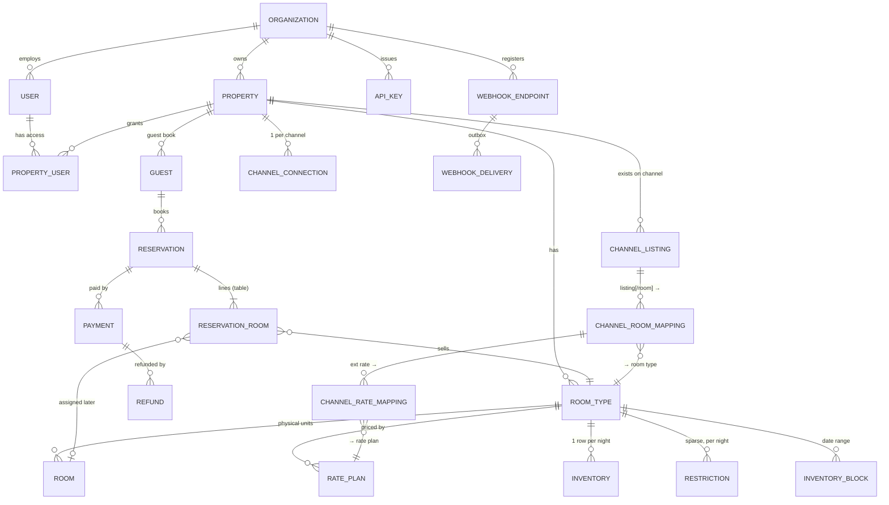

# Tirvona data architecture (PostgreSQL / Supabase)

PostgreSQL (verified on 17) · Kysely + `pg` · NestJS 11 · TypeScript. One database for the whole modular monolith,
hosted on Supabase. Supabase is used **only as hosted PostgreSQL**: authentication stays with the application's own JWT,
roles and API keys, and tenant isolation is enforced in the API code.

The code is the source of truth. This document explains the decisions and points to where each one lives.

| Topic | Where |
|---|---|
| Schema (31 tables, constraints, indexes, RLS, triggers) | [migrations/0001_init.sql](../backend/src/database/migrations/0001_init.sql) |
| Table types and row types | [db-types.ts](../backend/src/database/db-types.ts) |
| Pool, SSL, transactions, type parsers | [kysely.ts](../backend/src/database/kysely.ts) |
| Migration runner | [migrate.ts](../backend/src/database/migrate.ts), `npm run db:migrate` |
| Enums (mirrored by CHECK constraints) | [enums.ts](../backend/src/database/enums.ts) |
| Inventory and double-booking prevention | [inventory.service.ts](../backend/src/database/services/inventory.service.ts) |
| Reservations, cancellation | [reservation.service.ts](../backend/src/database/services/reservation.service.ts), [reservation-store.ts](../backend/src/database/reservation-store.ts) |
| Channel mapping | [channel-mapping.service.ts](../backend/src/database/services/channel-mapping.service.ts) |
| Webhook inbox | [webhook.service.ts](../backend/src/database/services/webhook.service.ts) |
| Outbox relay | [outbox.dispatcher.ts](../backend/src/jobs/outbox.dispatcher.ts) |
| Seed | [scripts/seed.ts](../backend/scripts/seed.ts) |
| Proof that it works | [scripts/verify.ts](../backend/scripts/verify.ts) (45 checks on real PostgreSQL), [test/](../backend/test/) |

---

## 1. Architecture

```
              ┌──────────── one PostgreSQL database (Supabase) ────────────┐
 NestJS       │  identity     organizations · users · property_users       │
 modular      │  property     properties · room_types · rooms              │
 monolith     │  commercial   rate_plans · promotions · restrictions       │
              │  inventory    inventory · inventory_blocks                 │
              │  bookings     guests · reservations · reservation_rooms ·  │
              │               payments · refunds                           │
              │  channels     channels · channel_connections ·             │
              │               channel_listings · channel_room_mappings ·   │
              │               channel_rate_mappings                        │
              │  plumbing     webhook_events (inbox) · sync_jobs (outbox)  │
              │               sync_logs · notifications · audit_logs       │
              │  auth/API     auth_sessions · password_reset_tokens ·      │
              │               api_keys · webhook_endpoints ·               │
              │               webhook_deliveries                           │
              └─────────────────────────────────────────────────────────────┘
```

**Principles**

1. **Tenancy is Organization → Property.** Operational rows carry `property_id`, and every query filters on it. The
   authorization layer resolves the caller's allowed properties from `property_users` and scopes each request.
   Isolation is enforced in the API (`PropertyAccessGuard`, `visibleProperties` for `/v1`), not in the database.
2. **Room type ≠ physical room ≠ channel listing.** Inventory is counted per room type per night. Physical rooms are
   assigned to reservation lines later. Channel listings map to room types, never to rooms.
3. **One master inventory.** TIRVONA and DIRECT read `inventory` directly. External OTAs receive pushes of the same rows.
4. **Every multi-row write is one transaction scoped to one property.**
5. **Integrations go through an inbox and an outbox.** Inbound webhooks land in `webhook_events` first. Outbound work
   (`sync_jobs`, `notifications`, `refunds`, `webhook_deliveries`) is written in the same transaction as the change that
   caused it, then handed to the queue by the outbox relay.
6. **Channel-agnostic core.** Nothing in the schema encodes an OTA wire format.

**Conventions**

- **Ids** are `uuid` (`id`, generated by PostgreSQL). The HTTP layer renames `id` to `_id` in responses (except `/v1`,
  which returns its documented field names), so the frontend and the SDK are unchanged.
- **Money** is a `bigint` in minor units (paise), parsed to a JS number (safe up to 2^53). ₹3,500.00 is `350000`.
- **Hotel dates** (`inventory.date`, `check_in`, `check_out`, restriction and block dates) are `date` columns, calendar
  dates in the property's time zone. They are read as a UTC-midnight `Date` and written/compared as `'YYYY-MM-DD'`
  (helper `d()` in [sql.ts](../backend/src/database/sql.ts)), so the server's time zone can never shift a day. Ranges are
  half-open: a stay `[check_in, check_out)` consumes the nights `check_in … check_out-1`.
- **Enums** are `text` columns with `CHECK (col IN (...))`. A test (`test/database.e2e-spec.ts`) fails if a CHECK list and
  the TypeScript enum drift apart.
- **jsonb** only for value objects that are always read and written with their parent: property/room images,
  cancellation policy and rate-plan snapshot, nightly rates, the guest snapshot, status history, metadata. Anything that
  is queried, joined or constrained is a real column or table.
- **Column naming:** snake_case in SQL, camelCase in code (Kysely `CamelCasePlugin`).

## 2. Relationships



A reservation is an **aggregate**: one `reservations` row plus its `reservation_rooms` lines. The service layer loads and
saves the two together ([reservation-store.ts](../backend/src/database/reservation-store.ts)). Each line stores its frozen
`nightly_rates`, `rate_plan` snapshot and totals, so later price changes never alter a booking.

## 3. Integrity enforced by the database

These hold for every writer, including a person with SQL access:

| Rule | Mechanism |
|---|---|
| `available + sold + blocked = total + overbooked`, all counters ≥ 0 | CHECK on `inventory` (`inventory_balance`) |
| `check_in < check_out`, `nights = check_out - check_in`, `total = subtotal + tax - discount`, `amount_refunded ≤ amount_paid` | CHECKs on `reservations` |
| OTA bookings carry an external id | CHECK `reservations_ota_external` |
| One reservation per `(source, external_reservation_id)`; one per `(property_id, idempotency_key)`; unique `reservation_code` | unique indexes |
| One payment per `(provider, provider_payment_id)`; one refund per `(provider, provider_refund_id)` | unique partial indexes |
| One inbound event per `(channel, external_event_id)` | unique constraint |
| One outbound event per `(endpoint_id, event_id)` | unique constraint (event emission is idempotent) |
| A listing belongs to exactly one property | unique `(channel, external_listing_id)` |
| One mapping per `(listing, room)`, null room treated as one value | unique index on `coalesce(external_room_id, '')` |
| Non-refundable plans are not refundable | CHECK on `rate_plans` |
| Audit logs are append-only | trigger rejects UPDATE and DELETE |
| `updated_at` is maintained | trigger on every table that has it |
| Enum membership | CHECK constraints (mirrored in `enums.ts`) |

Application-level validation (class-validator DTOs, service checks) sits in front of these and returns friendly errors;
the database is the last line. The error filter maps SQLSTATE `23505` → 409 `DUPLICATE`, `23503` → 409, `23514`/`22P02` → 400.

## 4. Indexes

Every index serves a named query. See the `create index` statements in `0001_init.sql`; the important ones:

| Table | Index | Serves |
|---|---|---|
| inventory | unique `(property_id, room_type_id, date)` | booking decrement, availability, calendar |
| reservations | `(property_id, check_in, check_out)`; `(property_id, status, check_in)`; `(guest_id, check_in desc)` | overlap/calendar; arrivals/in-house boards; guest history |
| reservations | partial `(hold_expires_at) where status='PENDING'` | hold-expiry sweeper |
| reservation_rooms | `(room_id) where room_id is not null`; `(room_type_id)` | room-assignment conflicts, tape chart |
| payments / refunds | unique partial on provider ids; `(status, created_at)` | gateway idempotency; refund worker |
| webhook_events | unique `(channel, external_event_id)`; `(status, created_at)` | idempotency; worker queue |
| sync_jobs | `(status, scheduled_at)`; partial purge index | worker claim; retention |
| notifications | `(status, created_at)`; unique partial `dedupe_key`; `(user_id, created_at desc)` | dispatcher; one reminder per booking; inbox |
| webhook_deliveries | `(status, enqueued_at)`; `(endpoint_id, created_at desc)`; partial purge index | outbox; delivery log |
| api_keys | unique `prefix` | key lookup |

`scripts/verify.ts` asserts with `EXPLAIN` (sequential scans disabled) that the inventory range read and the calendar
overlap query use indexes.

## 5. Double-booking prevention

These layers are independent. Each alone prevents `available < 0`.

1. **Row locks in fixed order.** A booking runs `SELECT ... FROM inventory WHERE (property, room type, nights) ORDER BY date FOR UPDATE`.
   Two transactions competing for the same nights queue on the row locks; the fixed order prevents deadlocks.
2. **Conditional update with a row-count check.** `UPDATE inventory SET available = available - q, sold = sold + q WHERE ... AND available >= q AND NOT stop_sell`;
   the service requires the affected row count to equal the number of nights, otherwise it throws `ROOM_NOT_AVAILABLE`.
3. **All-or-nothing across nights.** The statements run in one transaction; any failure rolls back the nights that did decrement.
4. **CHECK constraints.** `available >= 0` and the balance equation are enforced by PostgreSQL itself (SQLSTATE 23514).
5. **Physical rooms.** `assignRoom` and room-level blocks bump `rooms.assignment_version` and lock the room row inside their
   transaction before checking for overlaps, so concurrent assigners of the same room conflict (no write skew).
6. **Retries.** `runInTransaction` retries on serialization failure (40001) and deadlock (40P01).

`scripts/verify.ts` proves each with real concurrency: 25 simultaneous requests for 1 room give 1 booking and 24 sold out;
a multi-night stay with a sold-out middle night rolls back completely; 6 concurrent deliveries of the same OTA booking
give 1 reservation and 1 decrement; 5 concurrent cancels release inventory once; 2 stays racing for one room give 1 winner;
10 workers never claim the same sync job.

## 6. Transactions and queues

- **`runInTransaction(db, fn)`** wraps `BEGIN … COMMIT` with the retry above. Services take a `tx: Db` argument where code
  needs to join the caller's transaction.
- **No external I/O inside a transaction.** Callbacks can run more than once. Work for other systems is written as
  outbox rows and handed to the queue after commit.
- **Queue claims** use `UPDATE … WHERE id = (SELECT id … FOR UPDATE SKIP LOCKED LIMIT 1)`, so parallel dispatchers and workers
  never take the same row. Leases (`locked_until`) recover rows from crashed workers.
- **Outbox relay** ([outbox.dispatcher.ts](../backend/src/jobs/outbox.dispatcher.ts)) stamps `enqueued_at` on claimed rows,
  adds the BullMQ job, and a periodic pass re-dispatches stale rows. A crash between commit and enqueue delays work but never loses it.

## 7. Migrations

- Hand-written SQL in `backend/src/database/migrations/NNNN_name.sql`, applied in order, each in its own transaction.
- Recorded in `schema_migrations` with a checksum. A migration that changed after being applied is **refused**: never edit
  an applied file, add a new one. Forward-only.
- A PostgreSQL advisory lock serialises concurrent runners (two deploys starting at once).
- Run `npm run db:migrate` (compiled; `npm run build` first) before starting a new release. `npm run db:migrate:dev` runs it through `tsx`.
- `.sql` files are copied to `dist/` by `nest build` (`nest-cli.json` assets).

## 8. Supabase specifics

**Which connection string.** Supabase offers three. Put the one you choose in `DATABASE_URL`:

| Connection | Host / port | Use for |
|---|---|---|
| Direct | `db.<ref>.supabase.co:5432` | migrations; a single long-lived API or worker server (IPv6; use the pooler if your host has no IPv6) |
| Session pooler | `<region>.pooler.supabase.com:5432` | migrations and long-lived servers on IPv4-only hosts |
| Transaction pooler | `<region>.pooler.supabase.com:6543` | the app on serverless or with many instances. The code does not use named prepared statements, session variables or `LISTEN`, so it works in transaction mode. **Do not run migrations through it** (they hold a session-level advisory lock). |

**SSL.** `DATABASE_SSL=require` (the default for non-loopback hosts) encrypts the connection without verifying the
certificate. For production use `verify-full` with Supabase's CA certificate (Dashboard → Database → SSL configuration) in
`DATABASE_CA_CERT` (PEM text or a file path). `disable` is refused in production.

**Pool size.** `DATABASE_POOL_MAX` is per process. Keep `(API instances + worker instances) × DATABASE_POOL_MAX` below your
plan's connection limit (or use the transaction pooler, which multiplexes).

**Row Level Security.** Supabase exposes tables in the `public` schema through its auto-generated Data API (PostgREST) using
the `anon` and `authenticated` roles. This application never uses that API, so the migration enables RLS on **every table
with no policies** (deny all) and revokes table privileges from `anon` and `authenticated` when those roles exist. The
application connects as the database owner (`postgres` or a dedicated role), which is not subject to RLS. The result: the
public Data API can read nothing even if someone enables it or leaks the anon key. Do not add permissive policies. Turn
off the Data API in the project's API settings if you do not need it. RLS is a safety net here, not the tenancy
mechanism.

**Backups.** Use Supabase's daily backups and, for payments data, enable point-in-time recovery (paid add-on). Test a restore
into a scratch project: see [OPERATIONS.md](OPERATIONS.md). `npm run drill:restore` proves the data model survives a logical
restore and that the invariants hold, but it does not test Supabase's own backups.

**Which role the app uses.** Connect as the `postgres` role (which owns the tables and has `BYPASSRLS` on Supabase). A different
login role is subject to the deny-all RLS and would see **no rows** unless it owns the tables or has `BYPASSRLS`. If you want a
less privileged application role, create it with `BYPASSRLS` (or make it the table owner) and test the whole app against it first.

## 9. Retention

PostgreSQL has no TTL indexes. The scheduler task `purge-expired` (hourly, on the worker) deletes expired `auth_sessions` and
`password_reset_tokens`, `sync_logs` older than 90 days, successful `sync_jobs` older than 30 days, and DELIVERED/FAILED
`webhook_deliveries` older than 30 days. `audit_logs` are kept (archive them yourself after your retention period).

## 10. Local development and tests

- `npm run sandbox` starts a real PostgreSQL 17 (the `embedded-postgres` dev dependency ships the official binaries) in a
  temp directory, seeds Radha Ashram and runs the API. Nothing outside the process is touched; `backend/.env` is not used.
- `npm test` boots the full app against that same embedded server, one fresh migrated database per test file, dropped afterwards.
  `TEST_DATABASE_URL` points the tests at an existing **local** server instead (non-loopback hosts are refused).
- `npm run db:verify` runs the 45 concurrency/integrity checks. `npm run drill:restore` runs the backup/restore drill.
- Or run a local server yourself: `docker compose --profile local-db up postgres`.

## 11. Sample queries

```sql
-- Availability for a stay (3 nights): room types sellable for every night
select room_type_id, count(*) as nights, min(available) as min_available
from inventory
where property_id = $1 and date >= '2026-10-05' and date < '2026-10-08' and not stop_sell
group by room_type_id
having count(*) = 3 and min(available) >= 1;

-- The atomic decrement (inside a transaction, after locking the rows; check the row count = nights)
update inventory set available = available - 1, sold = sold + 1
where property_id = $1 and room_type_id = $2 and date >= '2026-10-05' and date < '2026-10-08'
  and not stop_sell and available >= 1;

-- Front desk
select * from reservations where property_id = $1 and status = 'CONFIRMED' and check_in = current_date;   -- arrivals
select * from reservations where property_id = $1 and status = 'CHECKED_IN';                                -- in-house

-- OTA lookup
select * from reservations where source = 'AIRBNB' and external_reservation_id = 'HMSEED0001';

-- Occupancy per night
select date, sum(sold)::float / nullif(sum(total) - sum(blocked), 0) as occupancy
from inventory where property_id = $1 and date >= '2026-10-01' and date < '2026-11-01' group by date order by date;

-- Integrity audit (should return 0 rows)
select id from inventory where available + sold + blocked <> total + overbooked or available < 0;

-- Operations
select channel, status, count(*) from sync_jobs where status in ('PENDING','RETRYING','FAILED') group by 1, 2;
select * from webhook_events where status = 'FAILED' order by created_at desc limit 20;
select * from reservations where overbooked and status in ('CONFIRMED','PENDING');
```

## Next steps

- **Date-level pricing.** Stays are priced from `rate_plans.base_price` (flat per night). A `rate_calendar` table keyed
  `(rate_plan_id, date)` is the natural next step; it is read in `ReservationService.priceLines` and `AvailabilityService`.
- **Tax** is a flat `properties.tax_percent`. Replace it with a rule table if slab-based rules are needed.
- **Partitioning.** `inventory` has about 1.1 k rows per property per year; a single table is fine for thousands of properties.
  If it grows past hundreds of millions of rows, partition by `date` range.
